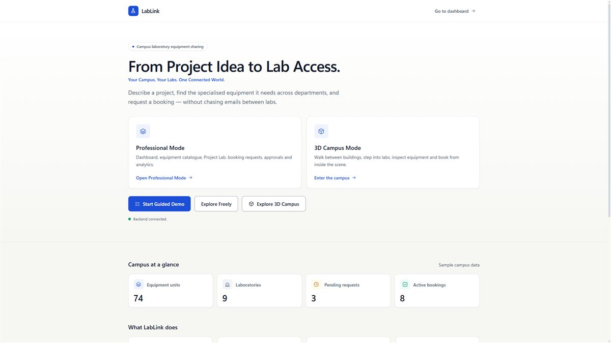
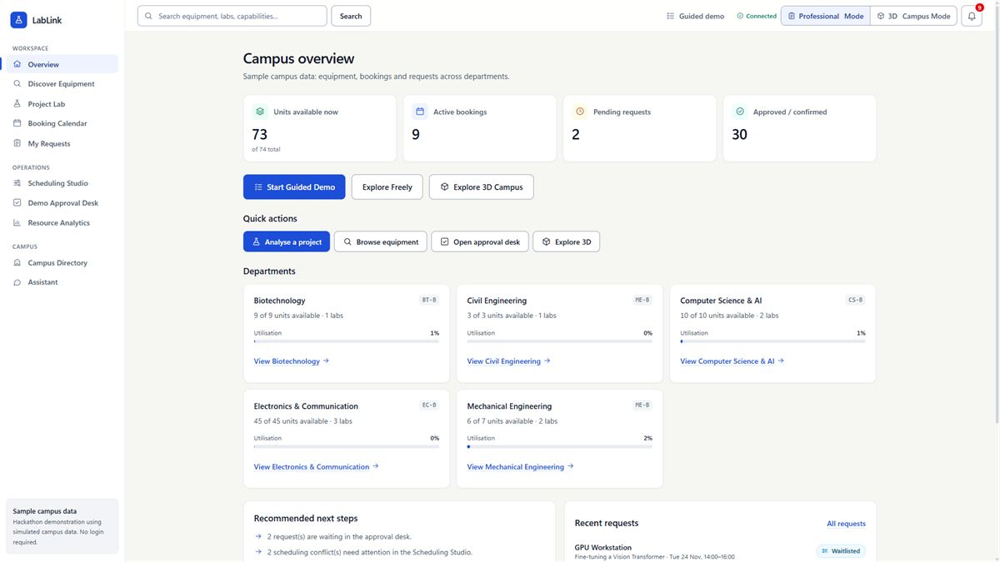
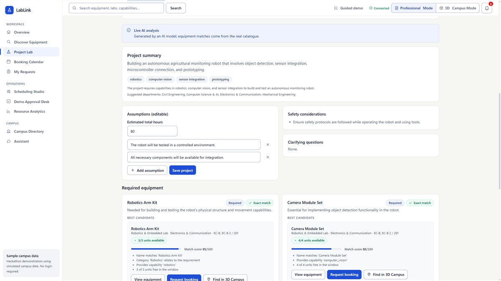
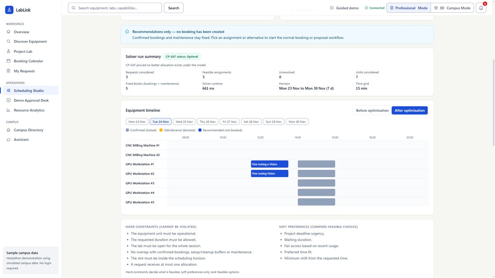
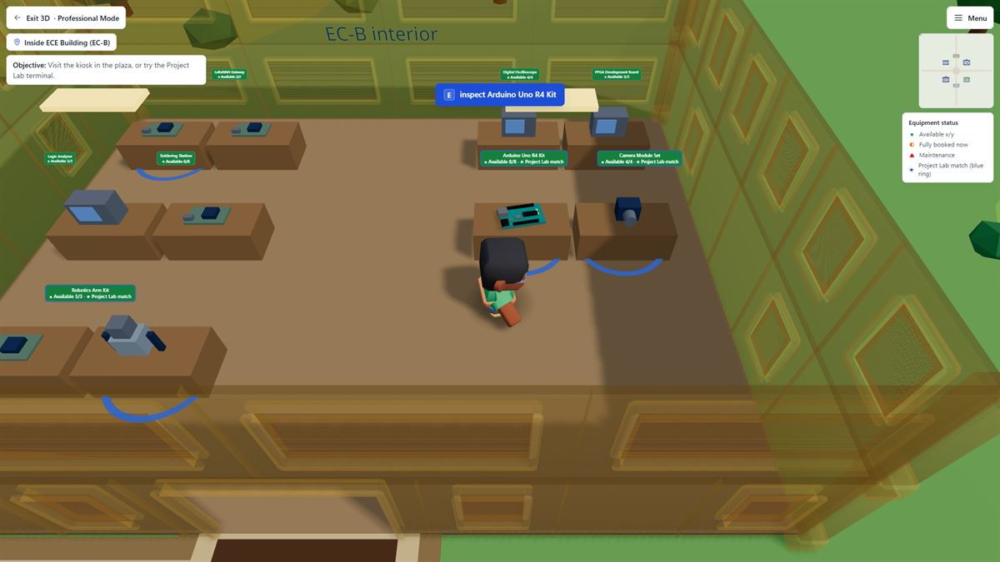
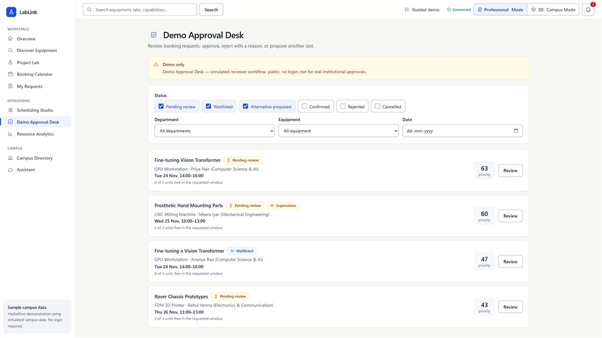
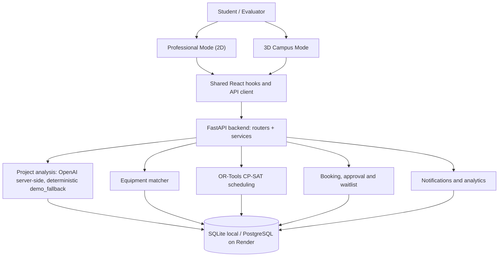
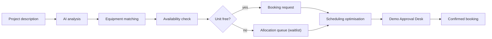

# LabLink — AI-Powered Campus Laboratory Resource Sharing

> **Your Campus. Your Labs. One Connected World.**
> Hack2Skill / Google for Developers Prompt Wars submission. Hackathon demonstration using simulated campus data. No login required.

| | |
|---|---|
| **Live demo** | https://google-for-developers-prompt-wars.vercel.app |
| **GitHub repo** | https://github.com/Mohammed-Bilal-Tanveer/PromptWars |
| **Hosted API** | https://promptwars-h1kz.onrender.com/api/v1 |
| **API docs** | Hosted: https://promptwars-h1kz.onrender.com/docs (returned HTTP 200 when checked); local: http://localhost:8000/docs |
| **Specs** | [`docs/API_CONTRACT.md`](docs/API_CONTRACT.md), [`docs/SPEC.md`](docs/SPEC.md) |

> The repository is named **PromptWars**; the product is **LabLink**. All campus data is fictional and the Approval Desk is a public simulation: no real approvals, no accounts.
>
> The free-tier backend may take up to a minute to wake after being idle. The app shows a "Waking up LabLink" banner and reconnects automatically (see [Backend cold-start behaviour](#backend-cold-start-behaviour)).

## Application Preview
Screenshots of the running app (fictional demo data).

| | | |
|---|---|---|
|  |  |  |
| Landing and guided demo entry | Professional Mode dashboard | AI Project Lab: requirements matched to real equipment |
|  |  |  |
| Scheduling Studio (OR-Tools decision visualiser) | 3D Campus Mode | Demo Approval Desk |

## Problem statement
Specialised lab equipment (GPU workstations, 3D printers, oscilloscopes, robotics kits) sits idle in one department while students in another cannot find it, do not know it exists, or cannot tell when it is free. Booking is usually manual and opaque, and contested slots are decided ad hoc.

## Solution overview
LabLink lets a student describe a project in plain language, extracts the equipment requirements with AI, matches them to **real catalogue records**, checks live availability, and files a booking request (or joins an allocation queue when every unit is busy). Google OR-Tools proposes a fair, explainable schedule; a public **Demo Approval Desk** simulates the faculty review that turns a request into a confirmed booking. The whole flow works in two interfaces that share one backend: **Professional Mode** (2D) and a game-like **3D Campus Mode**.

## Key features
- AI project analysis (OpenAI, server-side) with a labelled deterministic fallback; explainable equipment matching (score 0-100 with evidence).
- Live availability per unit, derived from bookings and maintenance windows (no stored counters); setup/cleanup buffers and lab opening hours.
- Booking requests, transactional approval, alternatives, cancellation, and an **allocation queue (waitlist)** that never reserves equipment.
- OR-Tools CP-SAT scheduling with a **decision visualiser** (summary, per-unit timeline, factor bars, alternatives).
- Demo Approval Desk, My Requests tracker, notifications, analytics and utilisation dashboards, maintenance windows.
- 10-step **guided demo**, opt-in **safe demo reset**, backend wake-up handling, accessibility hardening.

## Professional Mode vs 3D Campus Mode
| | Professional Mode (`/app`) | 3D Campus Mode (`/campus-3d`) |
|---|---|---|
| Style | Calm light dashboard UI | Low-poly campus (React Three Fiber), lazy-loaded |
| Data | Shared hooks in `frontend/src/hooks/useApi.ts` | The same hooks; equipment anchors read live status from the API |
| Features | Same feature components | The interaction registry opens the same panels (booking, equipment, scheduling...) |
| Navigation | Sidebar / mobile nav | Top **Menu**, **Map & Teleport**, click-to-walk, **E / Enter** to interact, mobile joystick + Sprint, **Find in 3D Campus** guidance |
| Fallback | - | WebGL failure or context loss shows a message with Retry 3D / return to Professional Mode |

3D extras: large coloured world (forests, pond, hills, clouds, boundary wall), hero models for Arduino / GPU workstation / 3D printer, and a few CC0 Kenney models.

## Architecture


Backend layout: `backend/app/api/routes/` (HTTP), `backend/app/services/` (`ai_service`, `equipment_matcher`, `availability_service`, `booking_service`, `approval_service`, `scheduling_service` + `scheduling_data`, `priority`, `notification_service`, `analytics_service`, `demo_service`), `backend/app/models/`, `backend/app/schemas/`, `backend/app/seed/`.

### User journey


## Vertical & approach
- **Vertical:** education / campus resource sharing (laboratory equipment discovery, booking, fair scheduling, utilisation analytics).
- **Approach:** *LLM interprets, deterministic code decides.* OpenAI (server-side only) turns free text into structured requirements; a deterministic matcher maps them to real DB equipment; availability/booking rules are enforced transactionally in the backend; OR-Tools recommends feasible, fair allocations. The LLM never invents equipment or availability and never confirms or mutates bookings.

## Logic overview
| Area | How it works |
|---|---|
| Availability | Derived from equipment **units** + confirmed bookings + maintenance windows. Half-open intervals `[start,end)`, setup/cleanup buffers, lab opening hours/days in `CAMPUS_TIMEZONE`. |
| Booking | `POST /booking-requests` validates all hard constraints, then creates `pending_review`. Approval re-checks availability **inside a transaction** (row locks on PostgreSQL) and only then creates a `confirmed` booking; conflicts return `409 SLOT_CONFLICT` with alternatives. |
| Allocation queue | If every unit is busy and the requester sends `join_waitlist: true`, the request becomes `waitlisted` (valid window only, duplicates rejected, **no booking, no reservation**). It shows an estimated `queue_position` (priority, then age), can be left (cancelled), is included in scheduling runs, and still needs reviewer approval. |
| AI analyser | Strict JSON-schema output re-validated by Pydantic; untrusted-input prompt; 10-minute cache; rate limit (10/min/IP). Missing key / timeout / invalid output gives a clearly labelled **Demo analysis** (`demo_fallback`). |
| Matching | Score 0-100 from exact name, category, capability overlap, lab/department preference and availability, with evidence strings. Nothing matched means `unmatched` (never fabricated). |
| Scheduling | CP-SAT over 15-minute slots per unit; hard constraints (no overlap, opening hours, operational units, min/max duration, maintenance, confirmed bookings fixed). Weights `0.40 deadline + 0.25 waiting + 0.20 fairness + 0.15 preference` (`W_*` env vars); fairness is identity-free. Output is a recommendation only; the response carries a solver `summary` and per-unit `timeline` for the visualiser. |

## Tech stack
| Layer | Technology |
|---|---|
| Frontend | React 18, TypeScript, Vite, Tailwind CSS 4, TanStack Query, Zustand, React Router, Recharts, React Three Fiber + drei (three.js) |
| Backend | Python 3.12, FastAPI, SQLAlchemy 2, Alembic, Pydantic v2 |
| AI / optimisation | OpenAI Chat Completions with JSON-schema output (server-side), Google OR-Tools CP-SAT |
| Database | SQLite (local default), PostgreSQL via `psycopg` (Render) |
| Hosting | Vercel (frontend), Render (backend + PostgreSQL) |
| Tests | pytest + FastAPI TestClient, Vitest + React Testing Library |

## Sample campus environment
All data is **fictional demo data** seeded by `backend/app/seed/` (catalogue in `catalog.py`; time-relative bookings and requests in `demo_data.py`). Counts verified by running the seed into a throwaway SQLite database.

| Item | Count |
|---|---|
| Departments | 5 |
| Laboratories | 9 |
| Equipment types | 22 |
| Physical equipment units | 74 |
| Seeded booking requests / bookings | 32 / 33 (25 historical completed, for analytics) |
| Active maintenance windows / example projects | 1 / 4 |

Departments: Computer Science & AI, Electronics & Communication, Mechanical Engineering, Civil Engineering, Biotechnology.

## Repository structure
```
backend/            FastAPI app (app/api, app/services, app/models, app/schemas, app/seed), alembic/, tests/
frontend/           React + Vite app (src/features, src/hooks, src/services, src/components, src/types), public/assets/
docs/SPEC.md        original product spec + implementation addendum
docs/API_CONTRACT.md  API source of truth
render.yaml         Render blueprint (backend + PostgreSQL)
vercel.json         Root-level Vercel config (frontend/vercel.json when Root Directory = frontend)
.env.example        Placeholder environment variables
```

## Run locally
Versions: Python 3.12 (Render pins `PYTHON_VERSION=3.12.5`; developed on 3.12.5). Node.js 18 or newer (the repo does not pin a Node version; Vite 6 needs 18+).

```powershell
# Backend: SQLite is used automatically when DATABASE_URL is empty
cd backend
python -m venv .venv
.venv\Scripts\activate
pip install -r requirements.txt
uvicorn app.main:app --reload --port 8000

# Frontend (new terminal)
cd frontend
npm install
npm run dev        # http://localhost:5173
```
You do **not** need to run `alembic upgrade head` or the seed script manually: with the default `DEMO_MODE=true`, backend start-up (`init_database()` in `backend/app/main.py`) runs the Alembic migration (falling back to `create_all`) and the idempotent seed. Running them by hand as well is unnecessary. API docs: http://localhost:8000/docs.

Optional: copy `.env.example` to `backend/.env` and set `OPENAI_API_KEY` (never exposed to the browser). Without it the analyser uses the labelled deterministic fallback. `.env` is read from the folder uvicorn is started in, and empty variables are ignored (`env_ignore_empty`).

## Environment variables
Backend variables are defined in `backend/app/core/config.py` (examples in `backend/.env.example` and the root `.env.example`); frontend variables are `VITE_*` and baked in at build time (`frontend/.env.example`).

| Variable | Purpose | Default | Used in |
|---|---|---|---|
| `DATABASE_URL` | Database connection; empty selects local SQLite; `postgres://` / `postgresql://` are normalised to `postgresql+psycopg://` | empty (`sqlite:///./lablink.db`) | backend |
| `OPENAI_API_KEY` | Enables live AI analysis (server-side only) | empty (labelled `demo_fallback`) | backend |
| `OPENAI_MODEL` | OpenAI model name | `gpt-4o-mini` | backend |
| `OPENAI_TIMEOUT_SECONDS` | OpenAI call timeout | `25` | backend |
| `OPENAI_MAX_INPUT_CHARS` | Max project text sent to the model | `8000` | backend |
| `CAMPUS_TIMEZONE` | Campus-local time for opening hours and naive timestamps | `Asia/Kolkata` | backend |
| `FRONTEND_ORIGIN` | CORS allow-list (comma-separated); localhost:5173 is always allowed | `http://localhost:5173` | backend |
| `DEMO_MODE` | Run migrations + idempotent seed on start-up | `true` | backend |
| `DEMO_RESET_ENABLED` | Opt-in "Reset demo scenario" (also needs `DEMO_MODE=true`) | `false` | backend |
| `W_DEADLINE` / `W_WAITING` / `W_FAIRNESS` / `W_PREFERENCE` | Priority weights | `0.40` / `0.25` / `0.20` / `0.15` | backend |
| `SOLVER_TIME_LIMIT_SECONDS` | CP-SAT time limit (capped at 5 s in code) | `5` | backend |
| `APP_ENV`, `APP_NAME`, `API_PREFIX`, `LOG_LEVEL` | Environment label, API title, route prefix, log level | `development`, `LabLink API`, `/api/v1`, `INFO` | backend |
| `VITE_API_BASE_URL` | Backend API base URL | `http://localhost:8000/api/v1` | frontend |
| `VITE_RENDER_FREE_TIER` | `true` switches the wake-up banner to free-tier wording ("up to a minute") | unset (false) | frontend |
| `VITE_BACKEND_WAKE_THRESHOLD_MS` | Startup probe slower than this shows the banner | `1800` | frontend |
| `VITE_BACKEND_WAKE_TIMEOUT_MS` | Recovery polling deadline before "unavailable" | `120000` | frontend |
| `VITE_BACKEND_HEALTH_POLL_MS` | Base health-poll interval (backs off to 3x) | `4000` | frontend |

`VITE_APP_MODE=demo` appears in `.env.example` files but is not read by any frontend code.

## API documentation
- Interactive FastAPI docs: `/docs` (Swagger UI) and `/openapi.json`, served at the host root (not under `/api/v1`). Hosted: https://promptwars-h1kz.onrender.com/docs. Locally: http://localhost:8000/docs.
- Health: `GET /api/v1/health` (liveness) and `GET /api/v1/health/ready` (checks the database; returns `"database":"postgresql"` on the hosted backend, `"sqlite"` locally).
- The hosted backend uses PostgreSQL; local development defaults to SQLite.
- Endpoint reference and schemas: [`docs/API_CONTRACT.md`](docs/API_CONTRACT.md).

## Testing and validation
| Check | What it covers | Result |
|---|---|---|
| Backend pytest (`cd backend && pytest -q`) | Unit + API integration tests via FastAPI `TestClient` on SQLite: availability, booking, approval, waitlist, matcher, AI fallback, scheduling, analytics, demo reset, config | **103 passed** |
| Backend query-count guard | `backend/tests/test_query_counts.py` guards against N+1 queries | included in the 103 |
| Backend lint (`ruff check .`) | Style/static checks | passes |
| Frontend Vitest + RTL (`cd frontend && npx vitest run`) | Components, guided demo, connection manager, booking form, 3D registry/HUD logic | **70 passed** (16 files) |
| Frontend TypeScript / build (`npm run lint`, `npm run build`) | `tsc` type-check and Vite production build | part of the project check command |
| Manual verification (done) | Browser checks of 3D controls (desktop browser, phone-sized viewport with synthetic pointer events), waitlist flow, a live OpenAI call locally, production `/departments` response time | done by hand, not automated |
| In progress / not recorded here | PostgreSQL concurrency testing and Playwright end-to-end tests are being run by the project owner; results are not recorded in this repository and no pass is claimed. The automated backend suite itself uses SQLite only; PostgreSQL is exercised by the hosted deployment | not claimed |
| Not done | Screen-reader and real-phone touch testing, CI pipeline | not done |

Accessibility: a source-level audit was done and its findings fixed (modal focus trap and focus return, 3:1 control borders, labelled form errors, 44 px touch targets, landmarks and page titles, keyboard-operable tabs).

## Deployment
Both services are deployed from their own sub-folder (set the **Root Directory** in each dashboard).

**Backend — Render, Root Directory `backend`** (`render.yaml` sets `rootDir: backend`). If you create the service by hand:

| Setting | Value |
|---|---|
| Runtime / Python | Python 3 with `PYTHON_VERSION=3.12.5` |
| Build command | `pip install -r requirements.txt` |
| Start command | `alembic upgrade head && uvicorn app.main:app --host 0.0.0.0 --port $PORT` |
| Health check path | `/api/v1/health/ready` |
| Env vars | `DATABASE_URL`, `APP_ENV=production`, `DEMO_MODE=true`, `CAMPUS_TIMEZONE=Asia/Kolkata`, `FRONTEND_ORIGIN=https://<your-vercel-domain>` (exact origin, no trailing slash), optional `OPENAI_API_KEY` / `OPENAI_MODEL`. Do **not** set `DEMO_RESET_ENABLED` on a public deployment. |

**`DATABASE_URL` pitfall:** Render's *Internal* database host (`dpg-...-a`) only resolves inside the same region/workspace (error `failed to resolve host`). Use the Internal URL only when the service and database share a region; otherwise use the **External Database URL**.

With `DEMO_MODE=true` the app runs migrations and the idempotent seed on start-up, so a fresh database needs no manual step.

**Frontend — Vercel, Root Directory `frontend`** (`frontend/vercel.json` adds the SPA rewrite). Leave Install/Build/Output overrides empty (Vite defaults: `npm ci`, `npm run build`, `dist`) and set `VITE_API_BASE_URL=https://<render-service>.onrender.com/api/v1`, then redeploy (baked in at build time). Optional: `VITE_RENDER_FREE_TIER=true`. (The root-level `vercel.json` only applies if the Root Directory is left at the repository root.)

## Backend cold-start behaviour
Free-tier hosts sleep when idle. Implemented in `frontend/src/features/connection/`:
- **Startup probe:** one `GET /health/ready` on load. If it is slower than the threshold (1.8 s by default) or fails, the app enters the *waking* state.
- **Status chip:** the Professional layout also shows a small Connected / Connecting... / Waking up... / Unavailable indicator.
- **Banner:** a non-blocking card titled **"Waking up LabLink"**, with "The demo server is waking up — this can take up to a minute on the free hosting tier..." when `VITE_RENDER_FREE_TIER=true` (otherwise generic wording), plus an elapsed-seconds / check counter, **Retry now** and **Hide** buttons. Hidden, it becomes a small **"Reconnecting..."** pill. There is no percentage progress bar.
- **Single-flight polling:** however many requests fail, one recovery loop runs and only one `/health/ready` request is in flight; the interval starts at 4 s and backs off (up to 3x).
- **Recovery:** on success the store becomes *connected*, the query cache is invalidated so active GET queries refetch, and a "LabLink is back online" toast appears. Pages are never unmounted, so form inputs are kept.
- **Unavailable:** after the polling deadline (2 minutes by default) the card becomes **"LabLink is still unavailable"** ("It may be starting, restarting or having an issue...") with **Try again**, and the pill reads **"Backend unavailable"**.
- **Mutations are never replayed:** a failed POST (booking, approval, cancellation) is flagged and, after recovery, the toast asks the user to retry the action manually.
- **Spinner and accessibility:** an indeterminate spinner (no numeric percentage); the status is announced through a visually hidden `aria-live="polite"` region; a global `prefers-reduced-motion` rule shortens animations (there is no separate reduced-motion variant of the banner).
- **Distinct stages:** loading the frontend from Vercel is independent of the backend; the app shell stays visible while the readiness probe runs. The states are `checking`, `connected`, `waking` and `unavailable` (reasons recorded: `startup_slow`, `network`, `gateway`, `health_check`, `timeout`).
- **Limitation:** the UI cannot always tell a sleeping server from a genuine network problem or an outage, which is why the wording says it "may be starting, restarting or having an issue". Query retries skip 4xx, transport and gateway (502/503/504) errors so queries do not hammer the API.

## Evaluator scenario
On the landing page choose **Start Guided Demo** (or **Explore Freely** / **Explore 3D Campus**). Then: **Project Lab**, **Use sample project**, analyse, open a matched equipment item, pick a window and submit a request. The seed deliberately books every GPU workstation unit for 14:00-16:00 on the next working day (the seed is time-relative, computed from the current date and `CAMPUS_TIMEZONE`), so requesting that slot demonstrates the conflict and the allocation queue. Continue in **Demo Approval Desk** (Approve / Reject / propose alternative), **My Requests**, **Scheduling Studio** (decision visualiser), **3D Campus** (Menu, Map & Teleport) and **Resource Analytics**.

Other UX details: the guided demo is a 10-step drawer that only links to screens and **never mutates data**; the opt-in **Reset demo scenario** needs `DEMO_RESET_ENABLED=true` and `DEMO_MODE=true` (off by default everywhere), a one-time 120 s token and the typed confirmation `RESET DEMO SCENARIO`, and deletes only non-seed rows.

## Assumptions & limitations
1. All campus data is fictional sample data. 2. No authentication/roles by design; the Demo Approval Desk is a public simulation, not for real approvals. 3. Requester names/departments are unverified display metadata. 4. Scheduling output is a recommendation; joining the queue reserves nothing. 5. Safety/supervision flags are demo metadata. 6. The 3D campus is low-poly, mostly procedural geometry plus a few CC0 Kenney models. 7. Render free-tier instances cold-start; the UI shows the wake-up banner and retry states. 8. 3D Enter-key, joystick and sprint behaviour is covered by unit tests and was checked in a desktop browser with a phone-sized viewport and synthetic pointer events; it has not been tried on a physical touch device. Idle equipment animations run on the "high" graphics setting.

## Hackathon submission checklist
Verified on this branch with the commands shown.

- [x] Public GitHub repository: https://github.com/Mohammed-Bilal-Tanveer/PromptWars
- [x] Single branch on the remote: `git ls-remote --heads origin` lists only `refs/heads/main`
- [x] Repository size under 10 MB: tracked files total about 2.9 MB (`git ls-files -z | xargs -0 du -cb`); git objects about 1.2 MiB (`git count-objects -vH`)
- [x] No secrets or databases committed: `git ls-files | grep -iE '\.env$|\.db$'` is empty (only placeholder `.env.example` files are tracked)
- [x] Live URL responds (frontend and hosted API `/health/ready`, `/docs`)
- [x] README covers vertical, approach, logic, assumptions, deployment and run instructions
- [x] Automated tests: 103 backend + 70 frontend passing (see [Testing and validation](#testing-and-validation); known gaps are listed there)
- [x] Screenshots in `docs/screenshots/` (six JPEGs, about 0.4 MB total)

## Asset credits & licence
3D models are by [Kenney](https://www.kenney.nl) under CC0 1.0 (public domain); details and the list of files used are in [`frontend/public/assets/ASSET_CREDITS.md`](frontend/public/assets/ASSET_CREDITS.md). Everything else in the scene is procedural. No separate licence file is included in this repository.

Product spec/roadmap: [`docs/SPEC.md`](docs/SPEC.md). API contract: [`docs/API_CONTRACT.md`](docs/API_CONTRACT.md).
